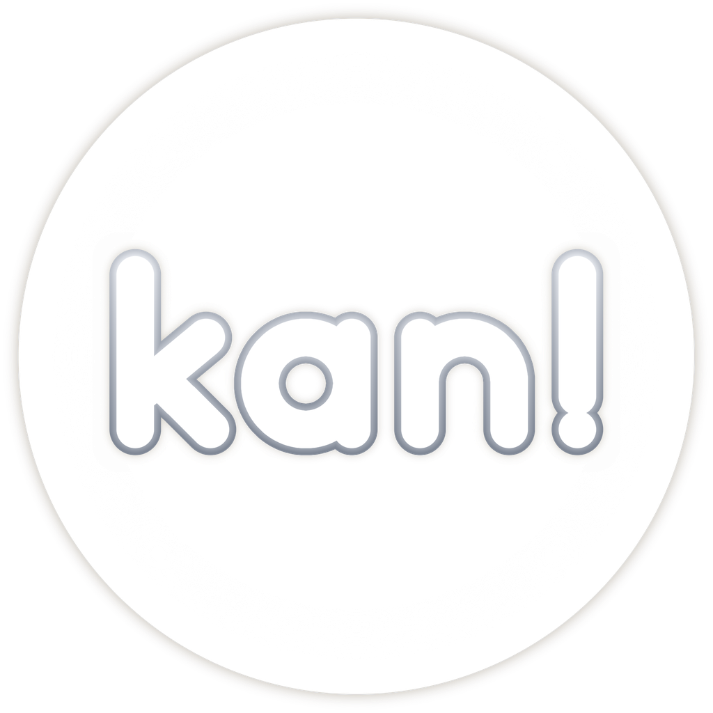

<p align="center">
  
</p>

# kan!

> *"Grab your instrument. You kan!"*

**kan!** is a free, open-source rhythm game you play on a **real
instrument**: flute, ocarina, violin, guitar, your voice, whatever you have.
A plain microphone is all it needs. Notes scroll along a staff, you play each
one as it reaches the line, and the game judges it by its timing and its
pitch, the way a rhythm game judges a key press.

The name comes from the Japanese **奏でる (*kanaderu*), "to play an
instrument, to make it sound"**. Read in English, it says the rest: grab your
instrument, you *kan*.

Practice made fun is the point. Rhythm games are great at making people
practise for hours; kan! points that at real music, so what players learn
goes home with them: to their church, their friends, their community. kan!
is calm by design. It is forgiving by default, strict only when you choose,
and it never uses anxiety or compulsion to keep you playing.

> **Collaboration language: English.** All code, comments, commits, docs and
> discussions in this repository are in English. See
> [CONTRIBUTING.md](CONTRIBUTING.md).

---

## Start playing

kan! runs on your own computer: free, offline, no account needed, and
nothing the microphone hears is recorded or sent. What you bring is an
instrument that plays notes and a plain microphone; the one in a laptop
is enough.

**Quickstart**

1. **Get kan!.** Download the zip for your system (Windows 10 or 11,
   macOS 13 or newer, or Linux, 64-bit) from the
   [releases page](https://github.com/KairoPhos13/kan-rhythm/releases) or
   the [website](https://kan.kairophos.link), unzip it and open kan!.
   kan! is not signed yet, so your system warns you the first time: on
   Windows choose *More info* and then *Run anyway*, on macOS
   control-click kan! and choose *Open*. Building it yourself works too:
   [game/README.md](game/README.md).
2. **Choose your instrument.** In song select, right under the level,
   kan! shows your instrument and the notes it plays; click it to change
   them, and the list of levels follows. Every level is fitted to your
   instrument's range, and kan! learns the instrument's own tuning and
   takes it off, so a slightly flat or sharp instrument is not punished.
3. **Play an easy level.** The first time kan! opens, five free starter
   levels are already in song select, no account needed: *Sakura Sakura*,
   *Kojo no Tsuki*, *Mo Li Hua*, *Xicochi* and *Amazing Grace*. They are
   easy to moderate, made for kan! from music that belongs to everyone,
   and each one starts with a bar of soft pulses so you hear the tempo
   before the first note. To take it gently, the *Wait for me* mod stops
   at every note until you play it.

**Where levels come from.** The five starter levels come with the game.
More levels come from players who make them in kan!forge and submit them
from the editor (*File > Submit level...*); the ranked ones appear in the
level listing. You can browse that listing in the game. A free account,
made on the [website](https://kan.kairophos.link) or in the game, is what
you download levels with, and what puts your scores on the leaderboards.
A level file shared with you directly works too: drag it into the game
and it appears in song select. To make your own, the
[level creator's handbook](game/docs/level-creation-guide.md) walks the
whole path, from a song on your computer to a level someone else can
play.

**Where the community lives.** In the
[issue tracker](https://github.com/KairoPhos13/kan-rhythm/issues): what
is being worked on, what is broken, and what players of each instrument
find. The [website](https://kan.kairophos.link) has the downloads and
accounts. To help or follow along, see [Join in](#join-in).

---

## What you can do

- **Play any instrument that plays notes.** Each level is fitted to your
  instrument's range, and your instrument's own tuning is learnt and taken
  off: a slightly flat or sharp instrument is not punished.
- **Learn with mods:** *Wait for me* stops at each note until you play it,
  *Practice* loops a section, *By heart* shows each note only for a moment,
  *Half Time* slows the level.
- **Make levels (kan!forge):** import a song, separate its instruments on
  your own computer, write or correct the score in a piano roll, and check
  it is playable before sharing it.
- **Play offline, or online if you like:** nothing is needed to play or make
  levels, and nothing the microphone hears is recorded or sent. kan!'s own
  small server adds accounts, level downloads and leaderboards.

More about how a play is judged: [game/docs/gameplay.md](game/docs/gameplay.md).

## Status

Playable and in daily testing on Linux, mostly with an alto ocarina, and
publicly released (v0.1.0 to v0.1.2, on the
[releases page](https://github.com/KairoPhos13/kan-rhythm/releases)).
Windows and macOS builds are produced by CI and still need testing on
real machines. Players of other instruments are especially welcome: see
[Join in](#join-in).

---

## Repository layout

This is a monorepo. Each top-level folder is self-contained, keeps its own
`README.md` and `TODO.md`, and could become its own repository later.

```
kan-rhythm/
├── game/        the kan! game: client (osu!lazer fork), game mode, kan!forge editor
├── libkan/      real-time C++ engine that listens: onsets, pitch, chords, tuning
├── kanfx/       real-time audio effects: buses, pitch shift, ducking
├── server/      online services: accounts, level catalogue, scores, leaderboards
├── web/         the website at kan.kairophos.link: what kan! is, downloads
├── charts/      level formats and free song candidates
├── apps/        developer apps on libkan (kan_demo live tuner, kan_analyze, kan_cli)
├── tools/       content tools: stem split, chart drafting, benchmarks
├── donations/   how kan! is sustained while staying free
├── assets/      shared art and sound (placeholder)
└── docs/        specification, roadmap, architecture, decision records (ADRs)
```

## Build and run

**The game** (requirements in [game/docs/environment.md](game/docs/environment.md)):

```bash
git clone --recurse-submodules https://github.com/KairoPhos13/kan-rhythm
cd kan-rhythm/game
make run
```

**libkan and its demo**, to hear what the engine hears:

```bash
cmake -B build -DCMAKE_BUILD_TYPE=Release
cmake --build build --parallel 6
./build/apps/kan_demo/kan_demo                 # free tuner, ocarina preset
./build/apps/kan_demo/kan_demo --instrument flute
ctest --test-dir build --output-on-failure
```

You need CMake 3.20 or newer, a C++20 compiler, and on Linux ALSA
(`libasound2-dev` on Debian and Ubuntu). The first configure downloads its
dependencies.

## How it works

- **libkan listens, the game judges.** libkan describes what it hears (when
  a note starts, which pitch, how in tune) in a few milliseconds, on the
  audio thread, without allocating or locking. The game decides what that
  means for the level being played.
- **The client** is built on osu!lazer: its menus, song select, scoring
  screens, replays and settings are a proven base, and kan! adds its own game
  mode and editor on top. Changes to that base are kept small and listed in
  [game/docs/fork-divergence.md](game/docs/fork-divergence.md).
- **Levels** are made in kan!forge from a song's audio: the companion (what
  plays along with you) and the score (what you play).

Full details: [docs/SPECIFICATION.md](docs/SPECIFICATION.md) ·
[docs/ROADMAP.md](docs/ROADMAP.md) · [docs/adr/](docs/adr/).

---

## Join in

kan! is playable and useful today, and still has a long way to go. It can
get there with help:

- **Issues are open to anyone.** Open work is listed in the
  [issues](https://github.com/KairoPhos13/kan-rhythm/issues) and in each
  folder's `TODO.md` (the game's: [game/TODO.md](game/TODO.md)). Issues
  labelled `good first issue` are a good place to start.
- **Musicians:** levels need songs that can be shared freely. If you write,
  play or arrange music (melodies and their accompaniments) and would release
  some of it under a free licence for kan!, you are very welcome.
- **Level creators:** turn a song into a playable level with kan!forge:
  [game/docs/level-creation-guide.md](game/docs/level-creation-guide.md).
- **Artists:** kan!'s logo, menu art, intro and sounds are still provisional:
  see [game/brand/](game/brand/README.md).
- **Players of other instruments:** kan! has been played mostly on an
  ocarina. Playing it on yours and reporting what feels wrong helps everyone.

See [CONTRIBUTING.md](CONTRIBUTING.md) before opening a pull request.

---

## Credits and licence

kan! is MIT licensed: see [LICENSE](LICENSE).

The game client is built on [osu!lazer](https://github.com/ppy/osu) by ppy
and its contributors (MIT), and kan! is grateful for it. "osu!" is a
trademark of ppy Pty Ltd; kan! is an independent project, not affiliated
with or endorsed by ppy. Third-party components and their licences are listed
in the game's `THIRD_PARTY_NOTICES` and in the `THIRD_PARTY_NOTICES.md` and
`LICENCE` files that ship in every release zip.
